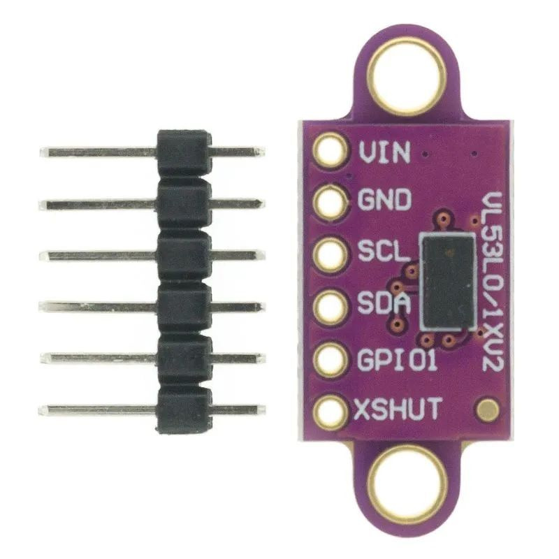

# VL53L0X for ESP-IDF

ESP32 integration of the **official STMicroelectronics VL53L0X API 1.0.4
(revision 4960)**, adapted for ESP-IDF.

The sensor API originates from STMicroelectronics. The ESP-IDF I²C
implementation was written by this project's author, using ESP-IDF's I²C
master driver. The platform layer also integrates ESP-IDF/FreeRTOS timing
and device handles.

This is an independent port and is not an official STMicroelectronics release.

## Project structure

- `components/vl530x/core/`: ST's VL53L0X API core.
- `components/vl530x/platform/`: platform integration, including the custom
  ESP-IDF I²C implementation.
- `components/vl530x/CMakeLists.txt`: ESP-IDF component registration.
- `main/main.c`: example application using continuous ranging and interrupts.

## Example connections

| Signal | ESP32 GPIO |
| --- | --- |
| SDA | 21 |
| SCL | 22 |
| Sensor interrupt | 18 |

The example uses the sensor's 7-bit I²C address `0x29`.
Adjust the GPIO configuration for your board and wiring.

## Example output

The example logs the measured distance in centimeters:

## License and attribution

The original STMicroelectronics copyright and license headers are preserved.
See [LICENSE](LICENSE) for the redistribution terms reproduced from the API
core; individual source headers retain their applicable terms.

When redistributing ST code, retain its copyright notices, conditions, and
disclaimer. Binary distributions must reproduce these notices in accompanying
materials. STMicroelectronics and contributor names must not be used to endorse
derived products without prior written permission.

In a [VL53L0X API licensing discussion on ST Community](https://community.st.com/imaging-sensors-49/library-vl53l0x-api-license-question-42945),
ST employee John E KVAM confirmed that the API could be published on GitHub
with the original ST headers retained (July 15, 2021). This port preserves
those headers, including the legacy notices in platform files. That public
clarification does not replace the license terms supplied with the source.
